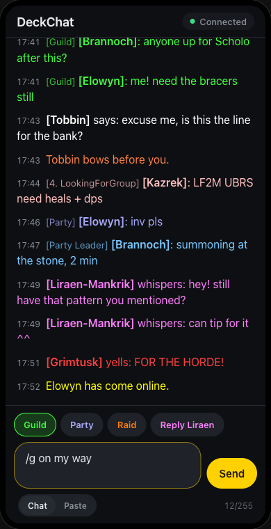
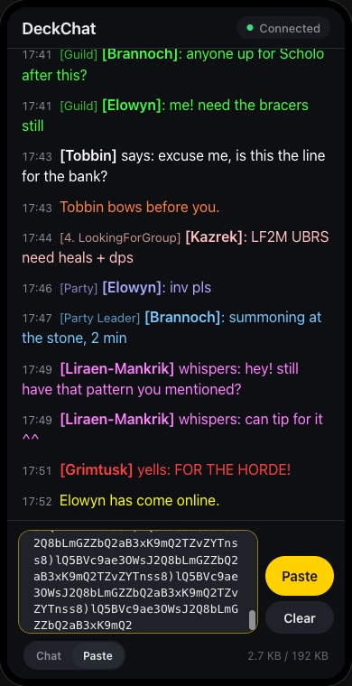

# DeckChat

Read and type World of Warcraft: Forever chat on your phone while you play on a Steam Deck.

<p>
  
  &nbsp;
  
</p>

> **Early release.** DeckChat is tested on Linux, but not yet on a real Steam Deck. If you try it, please [open an issue](https://github.com/stevenpetroff/steamdeckforever/issues) with what worked and what didn't.

- **Live chat on your phone**, in WoW's channel colors. Whispers, guild, party, raid, trade and the rest.
- **Type with your phone's keyboard**: autocorrect, swipe, dictation and emoji all work. Tap **Send** and the message goes into WoW's own chat box.
- **One-tap channels**: Guild, Party, Raid and Reply buttons. Tap a whisper to reply to it.
- **Paste mode**: paste a long string, like a WeakAura import, into any WoW text box.
- **Private**: no account, no app, no cloud. Your Deck and phone talk directly over your Wi-Fi, and nothing goes to the internet.

## What you need

- A Steam Deck (SteamOS 3) running WoW Forever through Steam and Proton.
- A phone on the same Wi-Fi, with any modern browser. There's no app to install.
- About 5 minutes in Desktop Mode for the first install.

## Install

1. On the Deck, switch to **Desktop Mode** (hold the power button, then **Switch to Desktop**).
2. Download the latest release:
   - Open the [Releases page](https://github.com/stevenpetroff/steamdeckforever/releases) in the Deck's browser and download `deckchat.tar.gz`, **or**
   - In **Konsole**:
     ```sh
     cd ~/Downloads
     curl -LO https://github.com/stevenpetroff/steamdeckforever/releases/latest/download/deckchat.tar.gz
     ```
3. In Konsole, unpack it and run the installer:
   ```sh
   cd ~/Downloads
   tar -xzf deckchat.tar.gz
   cd deckchat
   ./install.sh
   ```
   If it asks for a password and you've never set one, run `passwd` to set one, then run `./install.sh` again.
4. Switch back to **Game Mode** and start WoW Forever. If WoW was already running, quit and start it again, because a newly installed add-on needs a full restart.

<details>
<summary>What the installer changes on your Deck</summary>

- Copies the `deckchat` program to `~/.local/bin/deckchat`.
- Finds WoW Forever inside Steam's Proton folders and copies the `DeckChat` add-on into its `Interface/AddOns` folder.
- Adds a user service (`~/.config/systemd/user/deckchat.service`) so DeckChat starts with the Deck.
- Only if your Deck needs it: adds one system rule, `/etc/udev/rules.d/70-deckchat-uinput.rules`, so DeckChat can create its virtual keyboard. This is the only step that uses `sudo`.

It makes no network connections. `./uninstall.sh` removes all of it.
</details>

## Pair your phone

1. In WoW, type `/deckchat pair` in chat. A QR code appears.
2. Scan it with your phone's camera and open the link.
3. Chat appears on your phone. Add the page to your home screen so it's one tap away next time.

Your phone stays paired. Next time, just open the page while WoW is running.

## Use it

- **Send a message**: type, then tap **Send**. It goes to your current chat channel, like pressing Enter in WoW. `/g`, `/p`, `/w Name`, `/r` and other chat commands all work.
- **Switch channel**: tap **Guild**, **Party** or **Raid** to start the message with `/g`, `/p` or `/ra`. Tap it again to remove it.
- **Reply to a whisper**: tap **Reply Name**, or tap the whisper itself.
- **Paste into WoW** (for a WeakAura import, for example):
  1. In WoW, click the text box you want to paste into.
  2. On your phone, switch to **Paste**, paste or type the text, and tap **Paste**.

  The text goes into that box and nothing is pressed after it, so you can check it first.

DeckChat only sends when WoW is the window in front, and only one message per tap.

## Commands

| Where | Command | What it does |
|---|---|---|
| WoW | `/deckchat pair` | Shows the pairing QR code. |
| WoW | `/deckchat status` | Shows whether chat logging is on. |
| WoW | `/deckchat flush 5` | How often (in seconds, 1–30) chat is written to disk. Lower is faster on the phone. |
| Konsole | `deckchat doctor` | Checks the install. Run it in Game Mode with WoW open for the full check. |
| Konsole | `deckchat pair --reset` | Signs out every phone and makes a new pairing code. Then `/reload` in WoW and pair again. |

## Troubleshooting

- **The phone says "Not paired".** In WoW, run `/deckchat pair` and scan again.
- **The phone can't connect.** Check the phone is on the same Wi-Fi as the Deck, not mobile data or a guest network. If the Deck changed networks, `/reload` in WoW and pair again.
- **"WoW isn't in front".** Close the Steam overlay or on-screen keyboard and tap back into the game.
- **"Keyboard unavailable".** Run `./install.sh` again. A SteamOS update can remove the permission it needs.
- **Paste did nothing.** Click the text box in WoW so it has a cursor, then tap **Paste** again. If no box was selected, DeckChat blocks the paste and says so in chat. In combat it can't block it, so Ctrl+V does whatever you've bound it to.
- **The installer says it can't find WoW Forever.** Launch WoW once through Steam, then run `./install.sh` again. If it still can't find it, add the full path of your `_forever_` folder to `~/.config/deckchat/config.toml`:
  ```toml
  wow_path = "/home/deck/.local/share/Steam/steamapps/compatdata/<id>/pfx/drive_c/Program Files (x86)/World of Warcraft/_forever_"
  ```
  Then run `systemctl --user restart deckchat`.
- **Logs**: `journalctl --user -u deckchat -f`.

If you're stuck, [open an issue](https://github.com/stevenpetroff/steamdeckforever/issues) with the output of `deckchat doctor`.

## Update

Download the new release and run its `./install.sh`, the same as installing. Your phone stays paired. Restart WoW afterwards.

## Uninstall

Run `./uninstall.sh` from the unpacked release folder.

## Privacy and security

- Everything runs on your Deck and your phone. DeckChat has no server, account, analytics or update check, and makes no internet connections.
- The phone page is served by your Deck and only answers devices on your local network.
- Pairing uses a secret in the QR code. It's never sent over the network after you scan it, and every message from your phone is signed with it.
- Traffic on your Wi-Fi isn't encrypted, so someone on the same network could read your chat. Use DeckChat on networks you trust.

Found a security problem? See [SECURITY.md](https://github.com/stevenpetroff/steamdeckforever/blob/main/SECURITY.md).

## Blizzard's Terms of Use

**Use DeckChat at your own risk.** Blizzard's [End User License Agreement](https://www.blizzard.com/en-us/legal/fba4d00f-c7e4-4883-b8b9-1b4500a402ea/blizzard-end-user-license-agreement) (§1.C) prohibits third-party software it hasn't authorized that "changes and/or facilitates the gameplay or other functionality", and Blizzard doesn't approve tools in advance. DeckChat is designed to stay far from what Blizzard enforces against:

- It sends only what you write, one message per tap, and never on its own.
- It never presses game keys and never automates your character.
- It doesn't read or change the game's memory, files or network traffic. It reads the chat log WoW writes and uses a normal add-on.
- It gives no gameplay advantage.

Even so, no one can promise it's allowed. DeckChat isn't affiliated with or endorsed by Blizzard Entertainment. The phone page uses WoW's chat colors but no Blizzard art or fonts.

## How it works

| Part | What it does |
|---|---|
| `DeckChat` add-on | Keeps WoW's chat log on and writes it to disk every 2 s. Adds hidden key bindings that open a clean chat box. Shows the pairing QR code. |
| `deckchat` service | Reads the chat log and serves the phone page on your Wi-Fi. To send, it puts your message on the clipboard, then presses the add-on's hidden key, Ctrl+V and Enter on a virtual keyboard. |
| Phone page | A web page served by the Deck. |

Your message is pasted, never typed key by key, so a chat box that didn't open can't turn your letters into keybinds. The wire protocol is in [docs/protocol.md](https://github.com/stevenpetroff/steamdeckforever/blob/main/docs/protocol.md).

## Development

You need Go 1.26, Node 24 and Docker.

```sh
make test          # Go and phone unit tests
make test-linux    # virtual keyboard, X clipboard, focus and end-to-end tests in Docker
make lint-addon    # luacheck in Docker
make release       # dist/deckchat.tar.gz (linux/amd64)
test/linux/install-smoke.sh   # install/uninstall round trip in a container
```

To publish a release, push a tag such as `v0.2.0`. GitHub Actions builds it, runs the tests and attaches `deckchat.tar.gz` to the release.

- Design and requirements: [docs/plans/](https://github.com/stevenpetroff/steamdeckforever/tree/main/docs/plans)
- Checks still to run on a real Deck: [docs/research/deck-acceptance-checklist.md](https://github.com/stevenpetroff/steamdeckforever/blob/main/docs/research/deck-acceptance-checklist.md)
- Contributing: [CONTRIBUTING.md](https://github.com/stevenpetroff/steamdeckforever/blob/main/CONTRIBUTING.md)

## License

[MIT](LICENSE). The release also includes `THIRD_PARTY_LICENSES.txt` for the open-source libraries built into `deckchat`.
