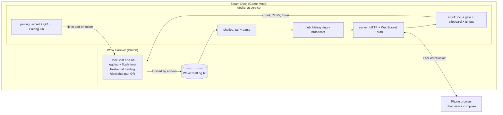
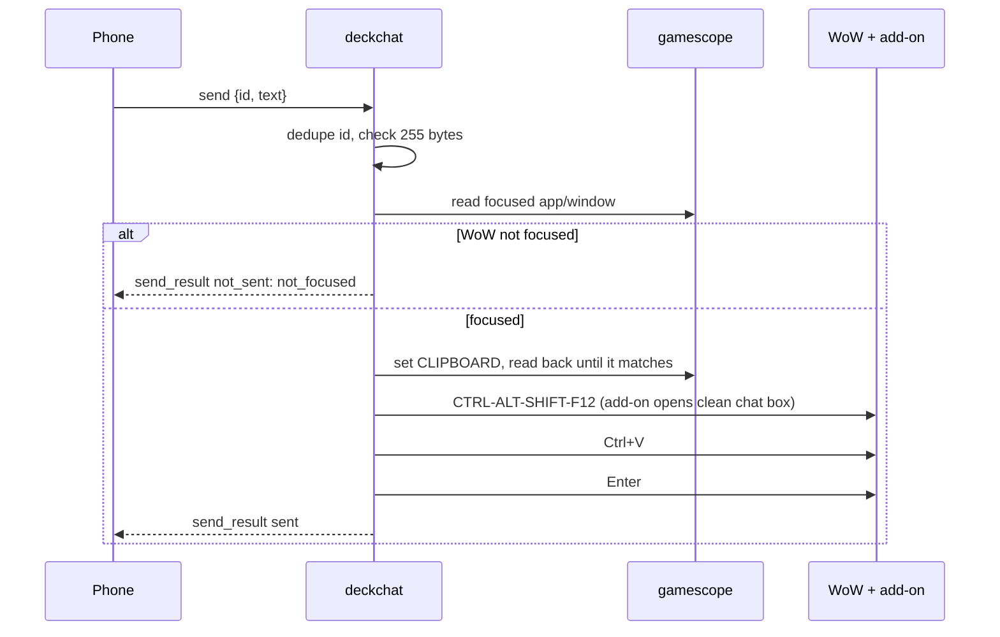

# Phone Chat Companion for WoW Forever on Steam Deck - Plan

## Goal Capsule

- **Objective:** A Steam Deck player in WoW Forever can read live game chat on the phone beside them and send chat messages typed on the phone keyboard, without touching the Deck's on-screen keyboard, whether the Deck is handheld or docked, with nothing leaving their home network.
- **Means:** A thin in-game add-on, a standalone `deckchat` service on the Deck that tails WoW's chat log and types through a virtual keyboard, and a WoW-themed phone web page the service serves over the LAN (KTD1, KTD2, KTD3).
- **Product authority:** The Product Contract below. Steam Deck (SteamOS Game Mode) only for v1. Windows handhelds and Decky Loader packaging are not active scope.
- **Stop conditions:** Stop and return to the user if U1's on-device spike shows any of these: forced chat-log flushing can't get chat to disk within ~5 s; virtual-keyboard input doesn't reach WoW in Game Mode; clipboard paste with Ctrl+V into WoW's chat box fails (KTD3); or neither the binding nor the edit-box hook can give a clean chat box (KTD4). Each one invalidates a settled read or write path.
- **Execution profile:** Spike first (U1) on real hardware, then the add-on, companion and phone units, then the installer. U3–U7 have off-device automated tests. U1 and U8 run entirely on the Deck, and U2–U6 each end with an on-Deck verification step.
- **Finish and ship:** The implementer delivers the units and the on-device acceptance checklist (Verification Contract). The player installs on their own Deck. There is no store submission.

---

## Product Contract

Product Contract preservation: changed. R16 was added (local-only, user-directed after the brainstorm). R12 was clarified to name the in-game pairing step chosen during planning. Outstanding Questions answered by planning research were resolved in place. All other meaning and IDs are unchanged.

### Summary

A Steam Deck companion for WoW Forever turns the player's phone into a WoW-themed chat screen and keyboard. The phone mirrors live chat with in-game look and behavior. The player composes a message with the phone keyboard and taps Send, and the message goes through WoW's own chat box. Everything runs on the player's Deck and phone over their local network.

### Problem Frame

Typing in WoW on a Steam Deck means summoning the on-screen keyboard over the game, pecking out a reply, and dismissing it. That's tolerable once and miserable for a whisper conversation. Docked to a TV it's worse, because the Deck's controls are the only input. The player usually has a phone within reach, with a far better keyboard, and nothing connects it to the game.

WoW Forever is Blizzard's official Classic+ realm (launched 2026-11-04), so the standard add-on sandbox and Terms of Use apply. Add-ons can't open network connections or write files during play, so no add-on alone can move chat to a phone. Anything outside the game that sends input to it is the most sensitive area under Blizzard's rules.

### Actors

- A1. **Player:** plays WoW Forever on a Steam Deck, handheld or docked, with their phone next to them.
- A2. **In-game add-on:** runs inside WoW Forever and is limited to what the add-on API allows.
- A3. **Deck companion:** the `deckchat` service. It runs in the background on the Deck alongside the game, connects the game and the phone, and serves the phone page.
- A4. **Phone page:** a web page opened in the phone's browser over the local network. No app-store install.

### Key Decisions

- **The phone acts as a general-purpose keyboard, not a WoW-specific automated sender.** Text reaches the game only as keystrokes into WoW's normal chat box, triggered one message at a time by the player. The risk reduction comes from the tool's general-purpose shape and the human trigger. The underlying mechanism is still synthesized keyboard input. Governs R6, R7, R9. (session-settled: user-directed — chosen over a companion that sends chat on the player's behalf, and over a read-only phone: the player wanted the lowest-risk input shape that still lets them reply from the phone)
- **The phone mirrors chat, not just keys.** Reading and typing happen in one place, so the player never has to look back at the Deck to follow a conversation. Governs R1, R2, R3. (session-settled: user-approved — chosen over keyboard-only and keyboard-plus-alerts: reading and replying on one screen is the core value)
- **Compose, then send.** The message is written in a real phone text box, so autocorrect, swipe and dictation work, and is sent with one tap. Governs R6. (session-settled: user-approved — chosen over live per-key passthrough: phone keyboard features only work in a local text field)
- **Chat reaches the phone through WoW's own chat log.** Reading the log Blizzard already writes sends no input to the game. The add-on forces periodic log flushes (KTD2). Governs R1, R11.
- **It behaves like in-game chat.** Sending goes through WoW's chat box, so sticky channels, slash commands and reply behavior are the game's own, not reimplemented. Governs R4, R5, R7.
- **Steam Deck Game Mode only for v1.** Governs R10. (session-settled: user-approved — chosen over Deck plus Windows handhelds, and over any PC: the Windows companion roughly doubles the work)
- **WoW theme from original art.** The phone page imitates Blizzard's visual style but ships no Blizzard files, so it can be shared publicly. The in-game add-on may use the game's own textures. Governs R13, R14. (session-settled: user-approved — chosen over using extracted Blizzard assets, and over pulling textures from the local install at runtime: copying assets blocks public distribution and invites takedowns)
- **Everything stays local.** No central API, cloud relay, account, telemetry or third-party asset host is involved at any point. Governs R12, R16. (session-settled: user-directed — stated as a hard constraint after reviewing the technical overview)

### Requirements

**Reading chat on the phone**

- R1. The phone shows WoW chat as it arrives, newest at the bottom, with sender name, channel and message, kept current while the game runs.
- R2. Channels look as they do in game: each channel type (say, yell, whisper, party, raid, guild, officer, general/trade/LFG, emotes, system) uses WoW's in-game color and its familiar `[Channel] [Name]:` prefix.
- R3. Outgoing whispers the player sends appear in the mirrored chat in WoW's outgoing-whisper style, so the phone reads as a full conversation.

**Sending from the phone**

- R4. Text the player sends is handled exactly as if they had typed it into WoW's chat box: plain text goes to the game's current sticky channel, and slash commands (`/w Name`, `/g`, `/p`, `/r`, `/1`, emotes) behave as they do in game.
- R5. Tapping a whisper (or any player-authored message) on the phone prefills a reply to that player in the compose box, the way the in-game reply key does.
- R6. The player writes the full message in a phone text box with the phone's native keyboard features, then sends it with one explicit tap. Nothing is sent without that tap.
- R7. Each Send delivers exactly that one message into the game and nothing else: no repeats, no scheduled sends, and no keys beyond what's needed to open the chat box, enter the text and submit it.
- R8. The phone warns before sending a message longer than WoW's chat limit, so nothing is silently cut off in game.
- R9. If the game isn't in a state to accept the message (for example, WoW isn't the focused window), the phone tells the player it wasn't sent instead of dropping it silently.

**Running on the Deck**

- R10. The companion runs on SteamOS in Game Mode without the player switching to Desktop Mode during play, and works the same handheld or docked.
- R11. The in-game add-on makes sure chat logging is on whenever the player is in game, without the player remembering a command.
- R12. Connecting the phone takes one short step: the player shows a pairing QR code in game and scans it. It works over local Wi-Fi with no internet service or account. Only a phone the player has paired can read chat or send.

**Look and feel**

- R13. The phone page is unmistakably WoW-themed: dark stone or parchment panels, gold beveled frames, WoW channel colors, and a serif display face in the spirit of the game's UI, all made from original or freely licensed art.
- R14. The phone page and any published package contain no files extracted from WoW and no Blizzard logos or trademarks used as branding.
- R15. The phone layout is built for one-handed, portrait use next to the Deck: chat fills the screen, the compose bar sits at the bottom, and the keyboard opening never hides the latest messages.

**Privacy**

- R16. All traffic stays between the Deck and the phone on the player's local network. The service makes no outbound internet connections and accepts no connections from outside the local network. The phone page loads every asset, fonts included, from the Deck.

### Key Flows

- F1. **Pair once.** **Trigger:** the player types `/deckchat pair` in game. The add-on shows a QR code, the player scans it, and the phone shows live chat from then on, including after reconnects. **Covers R10, R12, R16.**
- F2. **Reply to a whisper.** **Trigger:** a whisper appears on the phone. The player taps it, the compose box prefills a reply to that sender, the player types with the phone keyboard and taps Send. The message reaches the sender in game and appears on the phone as an outgoing whisper. **Covers R1, R3, R5, R6, R7.**
- F3. **Talk in a channel.** **Trigger:** the player types plain text or a slash command and taps Send. The game routes it exactly as typed in-game chat would. **Covers R4, R6, R7.**

### Acceptance Examples

- AE1. **Covers R4.** Given the player's last in-game channel was Guild, when they send `brb` from the phone, it appears in Guild chat. When they send `/p pulling`, it goes to Party.
- AE2. **Covers R5.** Given a whisper from Thrall is on screen, when the player taps it, the compose box reads as a reply to Thrall, and sending delivers a whisper to Thrall only.
- AE3. **Covers R8.** Given a message over WoW's chat length limit, when the player tries to send, the phone warns before sending, and no truncated message appears in game.
- AE4. **Covers R9.** Given WoW isn't the focused window, when the player taps Send, the phone shows that the message wasn't delivered and keeps the text in the compose box.
- AE5. **Covers R7.** Given the player is holding a movement key in game, when a phone message is sent, the message arrives intact and the player's movement input isn't left stuck.
- AE6. **Covers R16.** Given the Deck has internet access, while the service runs and the phone page is in use, no connection leaves the local network from either device on the app's behalf.

### Success Criteria

- A whisper exchange can be held entirely from the phone, with the Deck untouched, handheld or docked.
- Chat appears on the phone close enough to real time that a conversation feels live. Target: within about 2 seconds of appearing in game. Accepted floor: 5 seconds if U1 shows faster flushing is unreliable.
- Someone who plays WoW recognizes the phone page as WoW-styled at a glance.

### Scope Boundaries

**Deferred for later**

- Windows handhelds (ROG Ally, Legion Go) and plain desktop PCs.
- Push notifications to a locked phone or a backgrounded browser.
- Chat tabs and filters that mirror the player's custom in-game chat windows.

**Outside this product's identity**

- Any non-chat input from the phone: movement, abilities, macros, keybinds, targeting.
- Automated or scheduled messages, auto-replies, or anything that sends without a human tap per message.
- Remote access over the internet or from outside the player's network.

**Deferred to Follow-Up Work**

- Showing the current sticky channel on the phone's compose bar. The log doesn't record it, and the add-on has no live channel to the service.
- A "delivered" confirmation that matches each sent message against its echo in the chat log.
- Decky Loader packaging or a store listing.

### Dependencies / Assumptions

- WoW Forever's client exposes `LoggingChat()` to unprotected add-on code, and toggling it off and on flushes the chat log to disk. Research found this used by existing Forever add-ons. U1 confirms it on the Deck.
- A `/dev/uinput` virtual keyboard reaches the focused Proton game under gamescope in Game Mode. Shipping Decky plugins rely on this. U1 confirms it.
- `/etc` changes (a udev rule, only if one is needed) survive SteamOS updates. The service re-checks uinput access on each start and tells the player when it's missing.
- Blizzard's Terms of Use prohibit third-party software that sends input to the game. The player accepts the residual risk of a one-message-per-tap keyboard bridge.

### Outstanding Questions

**Deferred to Planning:** none remain. Read latency, input collisions and packaging are resolved in the Planning Contract (KTD2, KTD4, KTD1). The sticky-channel display moved to Deferred to Follow-Up Work.

### Sources / Research

- [Carve a New Path with World of Warcraft: Forever (Blizzard)](https://worldofwarcraft.blizzard.com/en-us/news/24302093) — official announcement.
- [World of Warcraft: Forever (warcraft.wiki.gg)](https://warcraft.wiki.gg/wiki/Forever) — client and patch reference.
- [WoW Forever release coverage (Shacknews)](https://shacknews.com/article/150712/world-of-warcraft-forever-classic-release-date-beta-sign-up) — launch date and access.

---

## Planning Contract

### Key Technical Decisions

- KTD1. **Standalone Go service, not a Decky plugin.** One statically linked `deckchat` binary embeds the phone page and fonts, runs as a systemd user service, and needs no runtime dependencies on SteamOS's read-only root. Go gives a single file, easy cross-compilation to the Deck's x86_64 Linux, and pure-Go X11 and WebSocket libraries. (session-settled: user-directed — chosen over a sideloaded Decky plugin: the player preferred no Decky dependency once the store's AI-authorship rule ruled out a store listing)
- KTD2. **Read path: the add-on forces flushes, the service polls file size.** WoW buffers `WoWChatLog.txt` until logout or `/reload`. The add-on toggles `LoggingChat(false)`/`LoggingChat(true)` on a repeating timer, with a 2 s default (configurable as a saved variable). The service polls file size every 250 ms rather than using inotify, because the toggle reopens the file. It handles truncation by reopening from offset 0. Governs R1, R11, Success Criteria.
- KTD3. **Write path: every message pasted, never typed.** The service puts the message on the gamescope X clipboard, then uses a `/dev/uinput` keyboard to press the add-on chord, Ctrl+V and Enter. Message characters are never sent as keystrokes, so a chat box that failed to open can't turn letters into keybinds. This also removes the keymap assumption and the multi-second typing window, and handles accents and emoji. Before pressing Ctrl+V, the service reads the clipboard back on the game's display until it matches the message. On a timeout it returns `not_sent: input_unavailable` without pressing any keys. Writing to uinput directly (no python-evdev or ydotool) keeps the binary self-contained. Governs R4, R7. (session-settled: user-approved — chosen over typed ASCII with paste only for non-ASCII, and over ASCII-only with no clipboard: typed letters become movement and ability keybinds whenever the chat box fails to open)
- KTD4. **A fresh chat box via the add-on, never Escape.** Escape opens the game menu when chat is closed. Instead, the add-on registers an override binding (default `CTRL-ALT-SHIFT-F12`) that clears and opens the chat edit box with `ChatFrameUtil.OpenChat("")`, which keeps the sticky channel. The older `ChatFrame_OpenChat` global exists in Forever only behind the `loadDeprecationFallbacks` CVar. It also hooks the edit box's key handler so the same chord clears an already-open box. The service's send sequence is: set and verify the clipboard, chord, Ctrl+V, Enter. Governs R4, R7, AE5.
- KTD5. **Focus gate before every send.** Before sending, the service reads `GAMESCOPE_FOCUSED_APP` and the focused window's name from gamescope's Xwayland root window. It sends only when the WoW window is focused. Otherwise it returns `not_sent: not_focused` and types nothing. Focus is re-checked before each key and before Enter. If focus is lost mid-send, the service releases the keys it pressed, skips Enter and returns `not_sent: focus_lost`. Governs R7, R9.
- KTD6. **Pairing secret delivered through the add-on folder.** On each start, the service writes `Interface/AddOns/DeckChat/Pairing.lua`. The file holds the pairing URL (`http://<lan-ip>:<port>/#<secret>`) and its QR module matrix, generated in Go. WoW loads the file at login or `/reload`, and `/deckchat pair` draws the matrix with textures. The secret is 128-bit random, created on the service's first run, and stored in a `0600` config file. `deckchat pair --reset` rotates it, rewrites `Pairing.lua` and closes every authenticated socket. Logs and `deckchat doctor` never print the secret or the full pairing URL. It travels in the URL fragment, which browsers never send to the server. The phone keeps it in `localStorage`. Governs R12.
- KTD7. **WebSocket protocol with challenge-response auth and idempotent sends.** The secret never crosses the network after pairing, because a portable Deck often sits on shared Wi-Fi where other devices pass the LAN guard.
  - **Auth:** after the upgrade the server sends `challenge {nonce}` (128-bit, single use). The phone answers `auth {mac: HMAC-SHA256(secret, nonce)}`, compared in constant time. A missing or wrong answer closes the socket with a policy-violation code.
  - **Sends:** each `send {id, ts, text, mac}` carries `HMAC-SHA256(secret, nonce ‖ id ‖ ts ‖ text)`. The server rejects a bad MAC, and a `ts` more than 10 s old, with no sender call.
  - **HMAC on the phone:** the phone bundles a small pure-JS HMAC-SHA256 and random-ID helper, because `crypto.subtle` and `randomUUID` aren't available on a plain-HTTP origin.
  - **Frames:** server frames are `challenge`, `history` (recent messages on connect), `message`, `send_result {id, outcome}` and `status`. Client frames are `auth` and `send`.
  - **`not_sent` reasons** are a closed set: `not_focused`, `focus_lost`, `too_long`, `invalid_text`, `input_unavailable`, `stale`.
  - **Idempotency:** sends are processed one at a time in order. The service stores the final `send_result` for each of the last 100 IDs. A repeated `id` gets the stored result replayed, or waits for the in-progress attempt, and is never sent twice.
  - Governs R7, R9, R12.
- KTD8. **Local-only by construction.** The server binds to the Deck's LAN interface addresses, not `0.0.0.0`. An address monitor polls every few seconds, opens a listener for each new private or link-local address and closes stale ones, so boot-before-Wi-Fi and suspend/resume work. The service runs fine with zero listeners. The same monitor triggers the `Pairing.lua` rewrite. The server drops connections whose remote address isn't private or link-local (RFC 1918, 169.254/16, fc00::/7, fe80::/10). It checks `Origin` on WebSocket upgrades. The binary has no HTTP client code paths. Fonts and CSS are embedded. The page sets a `Content-Security-Policy` of `default-src 'self'`. Governs R16, AE6.
- KTD9. **Phone page in vanilla TypeScript built by Vite.** There's no framework. The page is a chat list, a compose bar and a status line. The build output is embedded into the Go binary with `go:embed`. Fonts are Cinzel and Metamorphous (headers) and Marcellus (body), all SIL OFL, self-hosted. Governs R13, R14, R15.
- KTD10. **Byte-limited input on both ends.** WoW's limit is 255 UTF-8 bytes. The phone shows a live byte counter and blocks Send above the limit. The service re-checks and rejects with `not_sent: too_long`, so a modified client still can't produce a truncated message. Governs R8.
- KTD11. **Parser is fixture-driven.** Chat-log line parsing (`M/D HH:MM:SS.mmm` plus two spaces plus text) maps known patterns to channel types and sender names. Unrecognized lines become `system` messages and are never dropped. Fixtures come from a real Forever log captured in U1. Governs R1, R2, R3.

### High-Level Technical Design

**Component and data flow**



**Send sequence**



**Send states on the phone:** `composing` → `sending` → `sent` or `not_sent(reason)`, where the reason is one from KTD7 or `no_connection` after a 10 s timeout. On `not_sent`, the text stays in the compose box. A disconnect during `sending` resends the same `id` on reconnect only within the 10 s window (KTD7).

### Output Structure

```
addon/DeckChat/
  DeckChat.toc
  DeckChat.lua            -- logging, flush timer, binding, edit-box hook, /deckchat
  PairFrame.lua           -- draws QR matrix from Pairing.lua
  Bindings.xml
companion/
  go.mod
  cmd/deckchat/main.go
  internal/config/        -- paths, port, flags
  internal/wowpath/       -- find _forever_ install in Proton prefixes
  internal/chatlog/       -- tailer + parser (+ testdata/ fixtures)
  internal/hub/           -- history ring buffer + fan-out
  internal/server/        -- HTTP, WebSocket, auth, LAN filter, embed
  internal/input/         -- uinput keyboard, clipboard, sender
  internal/focus/         -- gamescope focus check
  internal/pairing/       -- secret, QR matrix, Pairing.lua writer
phone/
  package.json, vite.config.ts, index.html
  src/main.ts, src/socket.ts, src/chat.ts, src/compose.ts, src/channels.ts
  src/theme.css, src/fonts/ (OFL fonts + licenses)
  src/*.test.ts
install/
  install.sh, uninstall.sh
  deckchat.service, 70-deckchat-uinput.rules
docs/research/            -- U1 spike findings
```

### Assumptions

- Plain HTTP on the LAN is acceptable. After the QR scan the secret never travels on the wire (KTD7), and local HTTPS would force a self-signed-certificate warning on every phone. Residual risk: on a shared network a passive observer can read chat traffic. The README tells players to pair and play on networks they trust.
- The Deck's LAN IP changes rarely. The service rewrites `Pairing.lua` when its IP changes, and `/reload` picks up the edited file. If the phone can't reconnect, the player re-scans.
- The chord, Ctrl+V and Enter map to the same keycodes in any keyboard layout the player uses. U1 confirms this.

### Risks

- **Clipboard paste chain unproven** (gamescope clipboard to Wine to WoW edit box), and now required for every send. Mitigation: U1 tests it as a stop condition. The clipboard read-back guards against pasting stale contents.
- **Flush toggle cost or side effects at 2 s.** Mitigation: U1 measures frame impact and log integrity. The interval is a saved variable, with the accepted floor at 5 s.
- **Instance chat lockdown.** Forever restricts add-on access to chat in instances. Whether the log still records instance chat is unknown. U1 checks it in a dungeon. If it doesn't record, the phone shows a "chat paused in instance" status instead of silence.
- **Edit-box hook can't see the chord** while the box is focused. Mitigation: U1 tests it. The fallback is Ctrl+A before typing, if WoW's edit box supports select-all.
- **uinput access missing** (no rule needed on stock SteamOS, or a rule lost in an update). Mitigation: the service opens `/dev/uinput` lazily and retries, and reports `input_unavailable` on the phone status line with a re-run-installer hint.

### Sources & Research

- Chat logging API: [LoggingChat](https://warcraft.wiki.gg/wiki/API_LoggingChat), [C_ChatInfo.IsLoggingChat](https://warcraft.wiki.gg/wiki/API_C_ChatInfo.IsLoggingChat), and Forever's [ChatInfo docs](https://github.com/Gethe/wow-ui-source/blob/forever/Interface/AddOns/Blizzard_APIDocumentationGenerated/ChatInfoDocumentation.lua) and [SlashCommands.lua](https://github.com/Gethe/wow-ui-source/blob/forever/Interface/AddOns/Blizzard_ChatFrameBase/Shared/SlashCommands.lua). Shapes KTD2.
- Flush-toggle prior art: [AutoChatLog](https://github.com/ReneSarjeant/AutoChatLog), and a [Linux/Proton chat watcher with add-on and parser](https://github.com/dustinlyons/nixos-config/blob/main/modules/nixos/wow-chat-watch/wow_chat_watch.py). Shapes KTD2 and KTD11.
- Chat edit box and limits: [ChatFrameEditBox.xml](https://github.com/Gethe/wow-ui-source/blob/forever/Interface/AddOns/Blizzard_ChatFrameBase/Mainline/ChatFrameEditBox.xml), [ChatTypeInfoConstants.lua](https://github.com/Gethe/wow-ui-source/blob/forever/Interface/AddOns/Blizzard_ChatFrameBase/Shared/ChatTypeInfoConstants.lua) (channel colors for R2). Shapes KTD4 and KTD10.
- Game Mode input and focus: [gamescope steamcompmgr.cpp](https://github.com/ValveSoftware/gamescope/blob/master/src/steamcompmgr.cpp) (focus atoms, shared clipboard), and uinput Decky prior art [deckkm](https://github.com/dscrawford/deckkm) and [decky-macro](https://github.com/olivervbk/decky-macro). Shapes KTD3 and KTD5.
- Decky store rules: [plugin addition template](https://github.com/SteamDeckHomebrew/decky-plugin-database/blob/main/.github/PULL_REQUEST_TEMPLATE/plugin_addition.md). This drove KTD1.
- Terms: [Blizzard EULA](https://www.blizzard.com/en-us/legal/fba4d00f-c7e4-4883-b8b9-1b4500a402ea/blizzard-end-user-license-agreement), on automation of game control.
- Fonts: [Marcellus](https://github.com/google/fonts/tree/main/ofl/marcellus) and [Metamorphous](https://github.com/google/fonts/tree/main/ofl/metamorphous), both OFL.

---

## Implementation Units

### U1. On-device feasibility spike

**Goal:** Prove on a real Deck in Game Mode the four mechanisms everything rests on, capture real chat-log fixtures, and record the results.

**Requirements:** R1, R4, R7, R9, R11; KTD2, KTD3, KTD4, KTD5. Decides the Goal Capsule stop conditions.

**Dependencies:** none.

**Files:** `docs/research/2026-11-deck-spike.md` (findings), `companion/internal/chatlog/testdata/forever-sample.log` (anonymized real log), throwaway probe code under `spike/` (deleted by the end of U8).

**Approach:**
1. Minimal add-on: `LoggingChat(true)` on `PLAYER_LOGIN` and a flush toggle at 1, 2 and 5 s. Measure write latency from in-game message to on-disk line, and note any frame stutter.
2. Probe binary: create a uinput keyboard, check `GAMESCOPE_FOCUSED_APP` and the window name, and type a test string into WoW's chat.
3. Test the `CTRL-ALT-SHIFT-F12` override binding with chat closed, and the edit-box hook with chat open and part-typed.
4. Test X clipboard ownership on gamescope's Xwayland plus Ctrl+V with plain ASCII, accented text and an emoji. Send two different pasted messages back to back to check clipboard sync timing. This is a stop condition (KTD3).
5. Check whether dungeon party chat appears in the log.
6. Record which Xwayland display hosts the game and how a systemd user service finds it and its auth (for example, from the gamescope process environment or X sockets plus `GAMESCOPE_*` root atoms). Record the Proton prefix path layout and a 100+ line log sample covering every channel type in R2.
7. Check whether `/dev/uinput` is already writable by `deck` on stock SteamOS (for example, `getfacl /dev/uinput`), so the installer knows whether a udev rule and sudo are needed.
8. Confirm whether `/reload` picks up a newly added add-on folder or TOC-listed file, versus only edits to files that existed at launch.

**Execution note:** This is a spike. Prove on hardware and write down results. Production code starts in U2.

**Test expectation:** none -- exploratory spike. Its output is the findings doc and fixtures.

**Verification:** The findings doc answers each step with pass, fail or measured values, and states whether any stop condition triggered.

### U2. DeckChat in-game add-on

**Goal:** Keep chat logging on and flushed, provide the clean-chat-box binding, and show the pairing QR.

**Requirements:** R11, R12, R4, R7; KTD2, KTD4, KTD6; F1, AE1, AE5.

**Dependencies:** U1.

**Files:** `addon/DeckChat/DeckChat.toc`, `addon/DeckChat/DeckChat.lua`, `addon/DeckChat/PairFrame.lua`, `addon/DeckChat/Bindings.xml`, `addon/.luacheckrc`.

**Approach:**
- On `PLAYER_LOGIN`: enable logging, start the flush ticker (interval from `DeckChatDB.flushInterval`, default 2 s), and set the override binding out of combat.
- The binding handler clears the edit box text and calls `ChatFrameUtil.OpenChat("")`. The edit-box `OnKeyDown` hook clears the text on the same chord when the box is already open.
- `/deckchat pair` shows a draggable frame drawing `DeckChatPairing.matrix` as square textures, plus the URL as text. `/deckchat status` prints the logging state and flush interval.
- If `Pairing.lua` is missing, the pair command prints "start the deckchat service, then restart WoW".
- The TOC lists `Pairing.lua` as optional. The add-on uses only stock textures (R14 applies to the phone page).

**Patterns to follow:** Existing Forever add-ons that toggle `LoggingChat` (see Sources), and `Blizzard_ChatFrameBase/Shared/ChatFrameUtil.lua` in the Forever UI source for `ChatFrameUtil.OpenChat`.

**Test scenarios** (in-game, recorded in the on-device checklist):
- After login with chat logging previously off, `/deckchat status` reports logging on.
- A guild message appears in `WoWChatLog.txt` within the configured interval plus 1 s.
- Covers AE1. With Guild as the sticky channel and chat closed, the chord opens an empty edit box set to Guild.
- With the edit box open and containing `hel`, the chord leaves it empty and still open.
- During combat, the binding still opens chat, and no taint or "action blocked" error appears.
- `/deckchat pair` with `Pairing.lua` present shows a QR that a phone camera decodes to the URL. With the file absent, it prints the start-service hint. `/deckchat pair` after `deckchat pair --reset` and `/reload` shows the new QR.

**Verification:** luacheck passes. The in-game scenarios above pass on the Deck.

### U3. Companion skeleton, WoW install discovery and config

**Goal:** A runnable `deckchat` binary that finds the WoW Forever install and the add-on and log paths, with a config and logging foundation.

**Requirements:** R10; KTD1.

**Dependencies:** U1 (path layout).

**Files:** `companion/go.mod`, `companion/cmd/deckchat/main.go`, `companion/internal/config/config.go`, `companion/internal/wowpath/wowpath.go`, `companion/internal/wowpath/wowpath_test.go`.

**Approach:**
- Discovery searches `~/.local/share/Steam/steamapps/compatdata/*/pfx/drive_c/**/World of Warcraft/_forever_/`. A config file or flag can override the path.
- Config lives in `~/.config/deckchat/config.toml`: port (default 7480), WoW path override and the secret.
- Structured logs go to the systemd journal.
- `deckchat doctor` prints the install path, log path, uinput access and focus-probe results for troubleshooting, never the secret.

**Test scenarios:**
- A fake home tree with one compatdata prefix containing `_forever_` resolves to that path.
- Two prefixes with `_forever_`: the most recently modified wins, and both are logged.
- No install found: a clear error naming the searched globs, and the service keeps retrying every 30 s instead of exiting.
- A config override path that doesn't exist reports an error and doesn't fall back silently.

**Verification:** `go test ./...` passes, and `deckchat doctor` on the Deck prints the real paths.

### U4. Chat log tailer and parser

**Goal:** Turn appended chat-log lines into structured messages with channel, sender, text and timestamp, delivered to a history hub.

**Requirements:** R1, R2, R3; KTD2, KTD11.

**Dependencies:** U1 (fixtures), U3.

**Files:** `companion/internal/chatlog/tail.go`, `companion/internal/chatlog/parse.go`, `companion/internal/chatlog/parse_test.go`, `companion/internal/chatlog/tail_test.go`, `companion/internal/hub/hub.go`, `companion/internal/hub/hub_test.go`.

**Approach:**
- The tailer polls size every 250 ms, reads complete lines from the last offset, buffers a partial trailing line, and reopens from 0 on truncation or inode change.
- On startup it seeds the hub with the last 200 parsed lines.
- The parser emits `{ts, channel, channelName?, sender?, senderRealm?, text, outgoing}` for say, yell, whisper in and out, party/raid (+leader/warning), guild, officer, numbered channels, emotes and system. Unmatched lines become system.
- The hub keeps a ring of the last 500 messages and fans out to subscribers with non-blocking sends. A slow subscriber drops its oldest messages and gets a `resync` status.

**Test scenarios:**
- Each channel line in `forever-sample.log` parses to the expected channel and sender (table-driven over the fixture).
- `To [Thrall-Doomhowl]: hi` parses as an outgoing whisper with sender `Thrall` and realm `Doomhowl` (R3).
- `[2. Trade - City] [Bob]: WTS` sets channelName `Trade - City`.
- A line with an unknown shape becomes a system message with its full text kept.
- Edge: a partial line written without a newline isn't emitted until the newline arrives.
- Edge: file truncated to 0 bytes. The tailer restarts from the beginning without re-emitting old history.
- Edge: invalid UTF-8 bytes are replaced, not fatal.
- Integration: appending 3 lines to a temp file yields 3 hub messages in order within 1 s.

**Verification:** Tests pass. On the Deck, live chat appears in `deckchat doctor --follow` output.

### U5. Virtual keyboard, focus gate and sender

**Goal:** Deliver one phone message into WoW per send request, safely.

**Requirements:** R4, R7, R8, R9; KTD3, KTD4, KTD5, KTD10; AE1, AE4, AE5.

**Dependencies:** U1, U2 (binding chord), U3.

**Files:** `companion/internal/input/uinput.go`, `companion/internal/input/clipboard.go`, `companion/internal/input/clipboard_test.go`, `companion/internal/input/sender.go`, `companion/internal/input/sender_test.go`, `companion/internal/focus/focus.go`, `companion/internal/focus/focus_test.go`.

**Approach:**
- `Sender.Send(id, text)` runs these checks in order:
  1. Dedupe the `id` against the last 100 stored results (KTD7).
  2. Reject empty text or text containing a newline (`invalid_text`), and text over 255 bytes (`too_long`).
  3. Focus gate.
  4. Set the clipboard and verify the read-back, then press the chord, Ctrl+V and Enter.
- Each key gets a down/up pair. The sender only ever releases keys it pressed, so the player's held keys are untouched (AE5). Focus is re-checked before each key (KTD5).
- The service finds gamescope's Xwayland display and auth at runtime (per U1) rather than from the unit environment. It reconnects after gamescope restarts (for example, a Desktop-to-Game-Mode switch). It opens `/dev/uinput` lazily and retries, reporting `input_unavailable` until access appears.
- The keyboard and focus checker sit behind interfaces so tests use fakes.
- The clipboard owner sets `CLIPBOARD` on the gamescope Xwayland display found in U1. It serves `UTF8_STRING` requests until replaced.
- A send mutex serializes sends.

**Test scenarios:**
- Covers AE1. With a fake keyboard and clipboard, `/p pulling` sets the clipboard to exactly `/p pulling`, then produces chord, Ctrl+V, Enter and no other keys.
- Covers AE4. With the fake focus reporting a non-WoW app, the result is `not_sent: not_focused` and zero key events.
- A text of 256 bytes is rejected as `too_long` with zero key events. A text of exactly 255 bytes is accepted.
- The same `id` sent twice yields one key sequence and the original result twice.
- A first attempt that ends `not_focused`, retried with the same `id`, returns `not_focused` again with zero key events.
- A duplicate `id` arriving while the first attempt is typing waits and returns that attempt's result.
- The fake focus flips to a non-WoW app after the chord: no Ctrl+V or Enter, every key-down has a matching key-up, and the result is `focus_lost`.
- `/dev/uinput` not openable: the result is `input_unavailable`. Once the fake device becomes openable, the next send succeeds without a restart.
- `héllo 🙂` is pasted byte-for-byte through the same sequence.
- Clipboard read-back never matches within the timeout: `not_sent: input_unavailable` with zero key events.
- Covers AE5. The event log contains a key-up for every key-down the sender produced, and no key-up for keys it never pressed.
- Two concurrent sends run one after the other, never interleaved.

**Verification:** Tests pass. On the Deck, a CLI `deckchat send "/s test"` posts in Say.

### U6. Pairing, HTTP/WebSocket server and LAN guard

**Goal:** Serve the phone page and the authenticated WebSocket on the LAN only, and publish pairing info to the add-on.

**Requirements:** R12, R16, R7; KTD6, KTD7, KTD8; F1, AE6.

**Dependencies:** U3, U4, U5.

**Files:** `companion/internal/pairing/pairing.go`, `companion/internal/pairing/pairing_test.go`, `companion/internal/server/server.go`, `companion/internal/server/ws.go`, `companion/internal/server/languard.go`, `companion/internal/server/server_test.go`, `companion/internal/server/languard_test.go`, `companion/internal/server/embed.go`.

**Approach:**
- Pairing generates the secret at first run and stores it in a `0600` config file. `deckchat pair --reset` rotates it and closes open sockets (KTD6).
- On start and on any LAN IP change, pairing writes `Pairing.lua` (URL plus QR matrix from `skip2/go-qrcode`) atomically (temp file, then rename) into the add-on folder.
- The server binds the LAN addresses, applies the LAN guard and Origin check, and serves the embedded `phone/dist` with the CSP header.
- WebSocket handshake per KTD7: `challenge`, then a valid `auth` within 5 s, or the socket closes. After auth, the server sends `history`, then live `message` frames. Verified `send` frames go to the sender.
- Listeners follow the address monitor (KTD8).
- `status` frames report game focus, log freshness (last line time), uinput availability and the instance-chat note.

**Test scenarios:**
- Wrong auth MAC: the socket closes with a policy-violation code and no history is sent.
- A valid auth MAC captured from an earlier connection is rejected on a new connection (fresh nonce).
- A `send` with a missing or wrong MAC, or a `ts` older than 10 s, is rejected with zero sender calls.
- After `pair --reset`, the old secret fails auth and previously open sockets are closed.
- Log output from a full pairing and send session contains neither the secret nor the full pairing URL.
- The service starts with no LAN address. When an address appears, a listener opens on it and `Pairing.lua` updates. When the address disappears, its listener closes.
- No auth frame within 5 s: the socket closes.
- Correct auth: the first frame after auth is `history` with up to 500 messages, then live messages arrive in order.
- Covers AE6. The LAN guard accepts 192.168.1.20, 10.0.0.5, 172.16.4.2 and fe80::1, and rejects 8.8.8.8 and 2001:db8::1 (public-range IPv6).
- An upgrade request with a foreign `Origin` header is rejected.
- `send` with a duplicate `id` returns the stored result without a second sender call (KTD7).
- `Pairing.lua` written twice has a stable secret. Its URL updates when the IP changes, and the matrix decodes back to the URL.
- Static responses include `Content-Security-Policy: default-src 'self'`.

**Verification:** Tests pass. A phone on the same Wi-Fi loads the page by scanning the in-game QR.

### U7. WoW-themed phone page

**Goal:** The chat view and compose experience on the phone, styled like WoW, served entirely from the Deck.

**Requirements:** R1, R2, R3, R5, R6, R8, R9, R13, R14, R15, R16; KTD7, KTD9, KTD10; F2, F3, AE2, AE3, AE4.

**Dependencies:** U6 (protocol). It can be built against a mock socket in parallel with U4–U6.

**Files:** `phone/package.json`, `phone/vite.config.ts`, `phone/index.html`, `phone/src/main.ts`, `phone/src/socket.ts`, `phone/src/chat.ts`, `phone/src/compose.ts`, `phone/src/channels.ts`, `phone/src/theme.css`, `phone/src/fonts/` (Cinzel, Metamorphous, Marcellus and their OFL.txt files), `phone/src/socket.test.ts`, `phone/src/compose.test.ts`, `phone/src/channels.test.ts`.

**Approach:**
- `socket.ts` reads the secret from the URL fragment once, saves it to `localStorage`, and strips the fragment from the address bar. It answers the challenge and MACs each send (KTD7). It reconnects with backoff and resends an in-flight `send` with the same `id` only within the 10 s send window.
- **Not paired:** with no stored secret, or after a policy-violation close, the page stops retrying, clears the stored secret, and shows "Type /deckchat pair in WoW and scan the code".
- `channels.ts` maps each channel type to WoW's chat color and prefix format.
- `chat.ts` renders messages, newest at the bottom, auto-scrolling unless the player has scrolled up.
  - While scrolled up, a "N new messages" pill jumps back to the bottom.
  - `history` and `resync` replace the list, de-duplicated by message identity, keeping the scroll position.
  - Tapping a player-authored message prefills `/w Name-Realm ` (realm only when present). It replaces the compose text only when the box is empty or holds just a `/w ` prefill. Otherwise it asks "Replace draft with reply to Name?". A tap that is part of a scroll doesn't count.
- `compose.ts` provides the textarea, the UTF-8 byte counter, the Send button and the send state per the send states in High-Level Technical Design.
  - Enter inserts nothing, and newlines from paste or dictation are stripped. Only the Send button sends.
  - `sending` times out after 10 s into `not_sent(no_connection)`, with the text restored, and the player can cancel while sending.
  - Each `not_sent` reason maps to plain-language copy and a recovery hint, for example "WoW isn't in front — tap back into the game" or "Message too long — shorten by N bytes". The text is kept for every reason.
- The theme uses CSS-drawn stone and parchment panels, gold bevel borders built from gradients and box-shadow, and self-hosted fonts. There are no images from WoW.
- A `visualViewport` resize keeps the last message visible when the keyboard opens.
- The status line shows connection state, "WoW not focused", stale log, "chat paused in instance" and "keyboard unavailable — re-run the installer". Blocking states (not paired, disconnected, keyboard unavailable) take precedence over informational ones.

**Test scenarios:**
- Covers AE2. Tapping a whisper from `Thrall` with realm `Doomhowl` sets the compose text to `/w Thrall-Doomhowl ` with the caret at the end.
- Tapping a system message doesn't change the compose text.
- Covers AE3. Text of 256 UTF-8 bytes (e.g., 128 two-byte characters) disables Send and shows the over-limit warning. At 255 bytes Send is enabled.
- Covers AE4. A `send_result not_sent: not_focused` keeps the text in the compose box and shows the reason.
- A `sent` result clears the compose box.
- Each `not_sent` reason in KTD7 shows its mapped message and keeps the text.
- No reply in 10 s moves the state to `not_sent(no_connection)` with the text restored. A reconnect after the window doesn't resend.
- Tapping a whisper while the compose box holds a draft shows the replace prompt, and declining keeps the draft unchanged.
- With the list scrolled up, new messages show the pill without moving the scroll position. A `history` frame after reconnect doesn't duplicate existing messages.
- No stored secret, or a policy-violation close, shows the not-paired screen and stops reconnect attempts.
- A socket drop during `sending` resends the same `id` after reconnect, and the UI ends in `sent` once.
- Every channel type in R2 maps to a color and prefix, and unknown types fall back to system styling.
- A fragment secret is saved and removed from the URL. On reload without a fragment, the stored secret is used.
- The production build output contains no absolute `http(s)://` URLs except for license text (R16).

**Verification:** `npm test` and `npm run build` pass. On a real phone, the page looks WoW-styled, works one-handed in portrait, and the keyboard never covers the newest message.

### U8. Installer, service unit and on-device acceptance

**Goal:** One-command install and uninstall on SteamOS, auto-start in Game Mode, and the end-to-end acceptance pass.

**Requirements:** R10, R11, R12, R16; KTD1; all AEs on device.

**Dependencies:** U2, U6, U7.

**Files:** `install/install.sh`, `install/uninstall.sh`, `install/deckchat.service`, `install/70-deckchat-uinput.rules`, `README.md` (install, pairing, troubleshooting, ToS note), `docs/research/acceptance-checklist.md`.

**Approach:**
1. `install.sh` runs as the `deck` user and copies the binary to `~/.local/bin/`.
2. It installs and enables `deckchat.service` as a systemd user service. Lingering makes it start at boot, before the Game Mode session. The service itself waits for the gamescope display and uinput access (U5).
3. If `/dev/uinput` isn't already writable by `deck` (per U1), it installs the udev rule (`KERNEL=="uinput", TAG+="uaccess"`) with sudo. If `deck` has no password set, it tells the player to run `passwd` and re-run, instead of stopping halfway.
4. It copies the add-on into the discovered `Interface/AddOns/` and starts the service, so `Pairing.lua` exists.
5. It prints "restart WoW (or launch it), then type /deckchat pair". A brand-new add-on isn't picked up by `/reload`.

`uninstall.sh` reverses every step. The install makes no network calls. The binary and add-on come from the release archive the player downloaded.

**Execution note:** This is mostly packaging. Prove it with an install-run-uninstall smoke test on a real Deck rather than unit tests.

**Test scenarios** (on device, recorded in the checklist):
- On a fresh Deck, install, then reboot into Game Mode: the service is running and `deckchat doctor` passes.
- Covers F1. `/reload`, then `/deckchat pair`, scan: the phone shows live chat.
- Covers F2 / AE2, AE1, AE3, AE4, AE5. Run each on device, handheld and docked.
- Covers AE6. With a packet capture on the Deck, a 10-minute session shows no connections outside the LAN from `deckchat` or the phone page.
- Suspend and resume the Deck, and switch Desktop to Game Mode and back: the phone reconnects and sends work with no service restart.
- `deckchat pair --reset`, `/reload`, re-scan: the old phone shows the not-paired screen and the new scan works.
- Uninstall: the service, any udev rule, binary and add-on are gone, and the game still launches.

**Verification:** Every checklist item passes and is recorded with the date and Deck OS version.

---

## Verification Contract

| Area | Gate |
|---|---|
| Companion | `go vet ./...` and `go test ./...` from `companion/` pass. `GOOS=linux GOARCH=amd64 CGO_ENABLED=0 go build ./cmd/deckchat` produces a static binary. |
| Phone | `npm test` (Vitest) and `npm run build` from `phone/` pass. The build output is embedded into the companion build. |
| Add-on | `luacheck addon/` passes with the WoW globals config. |
| Local-only | A grep check in CI or by hand confirms no `http.Get`/`http.Client` use in `companion/`, and no external URLs in `phone/dist` (U7 scenario). |
| On device | `docs/research/acceptance-checklist.md` is complete for U2 and U8, covering AE1–AE6 and F1–F3, handheld and docked. |
| Latency | The median in-game to phone delay is at most 2 s over 20 messages (accepted floor 5 s per Success Criteria), measured during the U8 checklist. |

## Definition of Done

- Every R1–R16 is implemented and traced to a unit; AE1–AE6 pass on a real Deck.
- U1's findings doc exists, and no Goal Capsule stop condition triggered (or the user approved a change after one did).
- All Verification Contract gates pass.
- The README covers install, pairing, troubleshooting, the uninstall path and the Blizzard Terms of Use note.
- Cleanup: `spike/` and any abandoned-approach code are removed, with no dead code paths or unused dependencies left in the diff.
